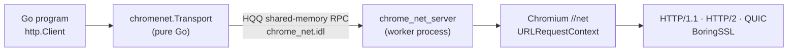

# chromenet: Chromium's network stack for Go

`gosuda.org/chromenet` sends Go HTTP requests through Chromium's own network stack: `//net` from an official Chromium release, with its HTTP/1.1, HTTP/2 and QUIC/HTTP/3 implementations, BoringSSL, Chrome's TLS configuration (GREASE, extension permutation, post-quantum key agreement, ALPS) and the Chrome Root Store. The stack runs in a separate worker process, `chrome_net_server`; the Go side is pure Go (`CGO_ENABLED=0`) and talks to it over [HQQ](https://github.com/gosuda/HQQ) shared-memory RPC.

```go
client := &http.Client{Transport: chromenet.NewTransport(chromenet.Options{})}
resp, err := client.Get("https://example.com/")
```

## How it works



- The worker binary for the current platform is embedded in the module (`internal/embedded`), written to the user cache directory on first use, verified against its pinned SHA-256 digest by `gosuda.org/hqq/secureexec`, and started with a lifeline (`--parent-stdin`): it exits when the Go process exits.
- Each request holds one engine session until its response body is closed. Transports with equal `Options` share one Chromium `URLRequestContext`, so connection pools, HTTP/2 sessions and QUIC sessions are reused.
- The Transport does not follow redirects and keeps no cookies; `http.Client` does both, as with `http.Transport`. Responses compressed with gzip, deflate, Brotli or zstd arrive decoded (`resp.Uncompressed` is true).
- Network failures are `*client.NetError` values carrying the Chromium error code and name, such as `ERR_NAME_NOT_RESOLVED`.

## Options

| Field | Effect |
|:---|:---|
| `UserAgent` | Replaces the default desktop Chrome User-Agent of the engine's Chromium version. A `User-Agent` request header still wins. |
| `AcceptLanguage` | Replaces `en-US,en;q=0.9`. |
| `Proxy` | Chromium proxy rules, such as `http://127.0.0.1:8080` or `socks5://127.0.0.1:1080`. Empty means direct. |
| `DisableHTTP2`, `DisableQUIC` | Turn the protocols off. |
| `ForceHTTP3` | Use QUIC for every origin without waiting for an `Alt-Svc` advertisement. |
| `InsecureSkipVerify` | Accept any server certificate. |
| `Pool` | Engine sessions to use; nil uses `client.DefaultPool()` (64 concurrent requests). |

`HQQ_CHROME_NET_SERVER=/path/to/chrome_net_server` replaces the embedded binary, for example with a local build.

`DialWebSocket` is a pure-Go RFC 6455 client and does not use the Chromium stack. `DialWebTransport` is an in-process implementation that does not reach a server.

## Platforms

`linux/amd64`, `linux/arm64`, `darwin/amd64`, `darwin/arm64`, `windows/amd64`, `windows/arm64`. The Linux engine needs only glibc 2.31 or newer (`libc`, `libm`, `libdl`, `libpthread`, `libgcc_s`); it verifies certificates against the Chrome Root Store compiled into `//net`.

## Tracking Chromium and building the engine

The engine follows Chromium Stable the way `gosuda.org/sqlite3` follows SQLite: the source is never vendored, only pinned.

| File | Pins |
|:---|:---|
| [`third_party/chromium/VERSION`](third_party/chromium/VERSION) | The Chromium release and its official source archive (`chromium-<version>-lite.tar.xz`). |
| [`third_party/chromium/SHA256`](third_party/chromium/SHA256) | SHA-256 of the archive and of every toolchain that release pins: clang, Rust, GN, ninja, the Windows clang runtime, xwin. |
| [`third_party/chromium/WINSDK`](third_party/chromium/WINSDK) | MSVC CRT and Windows SDK versions that xwin fetches from Microsoft. |
| [`scripts/engine/BUILDENV`](scripts/engine/BUILDENV) | The gvx sandbox (`rungv`) release, the guest image digest, and the Debian snapshot. |

[`scripts/engine/build.sh`](scripts/engine/build.sh) builds the engine from those pins. On a Linux x86-64 host it builds `linux-amd64`, `linux-arm64`, `windows-amd64` and `windows-arm64` inside a [gvx](https://github.com/gfire-sigs/gvx) sandbox with the clang that the Chromium release pins (Windows through clang-cl, lld-link and the xwin SDK). On a macOS arm64 host it builds `darwin-arm64` and `darwin-amd64` natively, because Chromium's macOS build needs Xcode.

```sh
scripts/engine/build.sh -w /scratch/chromenet linux-amd64     # Linux host
scripts/engine/build.sh darwin-arm64                          # macOS host
HQQ_CHROME_NET_SERVER=$PWD/dist/chrome_net_server_linux_amd64 go test ./...
```

[`engine/`](engine) holds the engine sources (`BUILD.gn`, the C API in `chrome_net.h`, the `//net` glue) that `scripts/engine/engine.py` copies into the Chromium tree as `//third_party/chromenet`, with the HQQ C runtime of the `gosuda.org/hqq` version in `go.mod`.

CI runs only on this repository:

| Workflow | Does |
|:---|:---|
| [`engine.yml`](.github/workflows/engine.yml) | Builds all six engines and runs the Go tests against them on each platform. |
| [`chromium.yml`](.github/workflows/chromium.yml) | Every six hours, pins a new Chromium Stable release (`engine.py pin --version latest-stable`) on a `chromium/<version>` branch and runs `engine.yml` on it. Once all six engines build and pass the tests, it attests them and pushes the pins, the binaries, `hashes.go` and the license texts to `main` as one commit. |
| [`release.yml`](.github/workflows/release.yml) | On a tag, builds the engines, attests their provenance, commits them with `internal/embedded/hashes.go` and publishes a release. |

Both bot commits reach gosuda/0 on their own: the monorepo's `OWNERS` grant `github-actions[bot]` exactly the files they write (`third_party/chromium/{VERSION,SHA256}`, `third_party/chromium/notices/*.txt`, `internal/embedded/hashes.go`, `internal/embedded/bin/chrome_net_server_*`). A change to anything else, such as `WINSDK` or `patches/`, still needs an owner.

Every embedded binary has a build provenance attestation from the workflow that built it:

```sh
gh attestation verify internal/embedded/bin/chrome_net_server_linux_amd64 --repo gosuda/chromenet
```

## Licensing

The Go code, the engine glue in `engine/` and the build scripts are under the [MIT License](LICENSE). `chrome_net_server` contains Chromium and its dependencies under their own licenses; [`third_party/chromium/notices`](third_party/chromium/notices) holds the license texts of each platform's binary, generated from its build graph by Chromium's `tools/licenses/licenses.py`.
